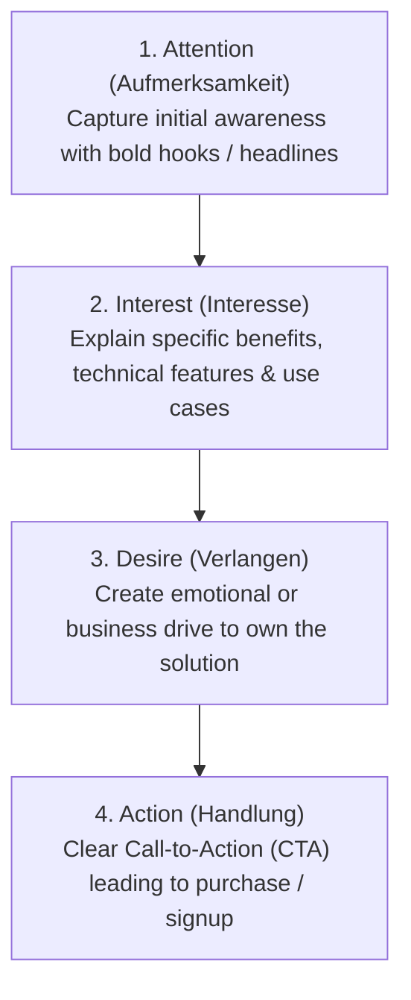

# Macro-Environmental Strategic Analysis (PESTEL) & The AIDA Marketing Funnel
*Date: 22-09-2026* | *Category: #business-strategy #market-research #marketing-models*

---

## Context — Kontext

**🇬🇧** Today at school (**Lernfeld 1.2**), we explored strategic frameworks for evaluating external market conditions and customer engagement: the **PESTEL Analysis** for diagnosing the macro-environment of an enterprise and the **AIDA Model** for modeling customer decision journeys in marketing and sales processes.

**🇩🇪** Heute haben wir im Unterricht (**Lernfeld 1.2**) strategische Instrumente zur Bewertung externer Marktbedingungen und Kundenbeziehungen behandelt: die **PESTEL-Analyse** zur Untersuchung des Makroumfelds eines Unternehmens und das **AIDA-Modell** zur Modellierung der Customer Journey in Marketing- und Vertriebsprozessen.

---

## Key Topics — Hauptthemen

### 1. PESTEL Macro-Environmental Analysis — PESTEL-Analyse

**🇬🇧** PESTEL evaluates external factors outside an enterprise's direct operational control that impact long-term corporate viability:
**🇩🇪** Die PESTEL-Analyse untersucht externe Einflussfaktoren, die außerhalb der direkten Kontrolle des Unternehmens liegen:

| Dimension | Meaning / Bedeutung | Key Examples in the IT & Data Sector |
|---|---|---|
| **P — Political (Politisch)** | Government policies, tax regulations, political stability / Steuerpolitik, Handelsabkommen. | Trade restrictions on microchips, public funding for AI research. |
| **E — Economic (Ökonomisch)** | Inflation rates, exchange rates, purchasing power, interest rates / Inflation, Zinsniveau. | Cloud hosting energy costs, IT hardware procurement inflation. |
| **S — Social (Soziokulturell)** | Demographics, consumer attitudes, remote work culture / Demografischer Wandel. | Shortage of skilled IT professionals (*Fachkräftemangel*), hybrid work expectations. |
| **T — Technological (Technologisch)** | Disruptive tech, automation, R&D innovations / Technologische Innovationen. | Large Language Models (LLMs), quantum computing, edge computing architectures. |
| **E — Environmental (Ökologisch)** | Carbon footprint, energy consumption, green IT / Nachhaltigkeit, Klimaziele. | Data center cooling energy efficiency, e-waste regulations. |
| **L — Legal (Rechtlich)** | Employment law, data protection, copyright, compliance / Gesetzliche Rahmenbedingungen. | **DSGVO / GDPR compliance**, EU AI Act, trade secrets act (GeschGehG). |

---

### 2. The AIDA Model (Customer Conversion Journey) — Das AIDA-Modell

**🇬🇧** AIDA outlines the psychological progression a customer traverses before completing a commercial transaction:
**🇩🇪** Das AIDA-Modell beschreibt die vier Stufen, die ein Kunde bis zum Kaufabschluss durchläuft:

| Phase | Objective / Ziel | Digital Marketing & UX Application |
|---|---|---|
| **A — Attention** | Break through sensory overload / Wahrnehmung wecken. | High-contrast UI banners, SEO keywords, targeted social ads. |
| **I — Interest** | Deepen engagement / Interesse vertiefen. | Clear product feature matrix, technical case studies, live demo videos. |
| **D — Desire** | Build intent to purchase / Kaufwunsch auslösen. | Free trials, ROI calculation tools, client testimonial reviews. |
| **A — Action** | Trigger conversion / Kauf ausführen. | Frictionless checkout, "Start Free Trial" CTA button, direct sales contact form. |

---

## Key Takeaway — Was ich gelernt habe

**🇬🇧**
- **External factors dictate IT strategy:** A company building a cloud SaaS platform cannot simply code features — PESTEL reveals that legal frameworks (DSGVO) and economic factors (cloud hosting energy costs) fundamentally bound the software architecture.
- **AIDA is a conversion pipeline:** In process analysis, analyzing the drop-off rate between Attention $\rightarrow$ Interest $\rightarrow$ Desire $\rightarrow$ Action identifies the exact bottleneck in a sales workflow.

**🇩🇪**
- **Externe Faktoren steuern IT-Strategie:** Die Entwicklung von Cloud-Software erfordert den Blick auf das Makroumfeld — PESTEL zeigt, wie Gesetze (DSGVO) und wirtschaftliche Rahmenbedingungen (Serverkosten) die Architektur bestimmen.
- **AIDA ist eine Conversion-Pipeline:** In der Prozessanalyse deckt die Messung von Abbrüchen zwischen Attention, Interest, Desire und Action exakt den Engpass im Vertriebsprozess auf.
