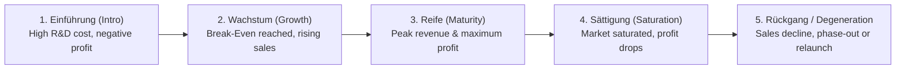

# Product Life Cycle (PLC) & The BCG Growth-Share Portfolio Matrix
*Date: 25-09-2026* | *Category: #product-management #portfolio-analysis #strategic-management*

---

## Context — Kontext

**🇬🇧** Today we concluded **Lernfeld 1.2 (Business Processes & Market Environment)**. We analyzed the standard **Product Life Cycle (*Produktlebenszyklus*)** across its financial phases (revenue, profit, break-even) and mastered the **BCG Growth-Share Matrix** (Boston Consulting Group portfolio model) to balance cash flow and strategic investments.

**🇩🇪** Heute haben wir **Lernfeld 1.2 (Geschäftsprozesse und Marktumfeld)** abgeschlossen. Wir haben die Phasen des **Produktlebenszyklus** (Umsatz, Gewinn, Break-Even-Point) analysiert und die **BCG-Matrix** (Portfolio-Analyse der Boston Consulting Group) zur strategischen Steuerung von Cashflow und Investitionen erarbeitet.

---

## Key Topics — Hauptthemen

### 1. The 5 Phases of the Product Life Cycle — Der Produktlebenszyklus

**🇬🇧** Every product traverses a characteristic lifecycle from launch to decline:
**🇩🇪** Jedes Produkt durchläuft einen typischen Lebenszyklus von Markteinführung bis Degeneration:

| Phase / Lebensphase | Sales / Umsatz | Profit / Gewinn | Strategic Focus / Ziel |
|---|---|---|---|
| **1. Einführung (Introduction)** | Low, slow initial growth / Gering | 🔴 Negative (high development & marketing cost) | Build brand awareness, establish distribution channels. |
| **2. Wachstum (Growth)** | Rapid expansion / Stark steigend | 🟢 Positive (crosses **Break-Even-Point**) | Scale production, fend off emerging competitors. |
| **3. Reife (Maturity)** | Reaches peak volume / Maximum | 🏆 Maximum profitability (economies of scale) | Maximize market share, optimize operating margins. |
| **4. Sättigung (Saturation)** | Growth stagnates, starts falling / Rückläufig | 🟡 Declining profits due to aggressive price wars | Product differentiation, cost reduction, feature updates. |
| **5. Degeneration (Decline)** | Sharp decline / Stark fallend | 🔴 Approaches zero or becomes negative | Product phase-out, harvest remaining cash, or relaunch. |

---

### 2. The BCG Growth-Share Matrix — BCG-Portfolioanalyse

**🇬🇧** Developed by the Boston Consulting Group, this $2 \times 2$ matrix maps business units/products based on **Market Growth Rate** (vertical) and **Relative Market Share** (horizontal):
**🇩🇪** Die BCG-Matrix teilt Produkte anhand von **Marktwachstum** und **relativem Marktanteil** in vier strategische Quadranten ein:

| | High Relative Market Share / Hoher Marktanteil | Low Relative Market Share / Geringer Marktanteil |
|---|---|---|
| **High Market Growth / Hohes Marktwachstum** | 🌟 **STARS** High investment needed to maintain leadership, but generates strong revenue. Target: Keep growing into future Cash Cows. *Normstrategie: Investieren / Halten* | ❓ **QUESTION MARKS** New products in high-growth markets with uncertain success. High cash drain. *Normstrategie: Selektiv investieren oder abstoßen* |
| **Low Market Growth / Geringes Marktwachstum** | 🐄 **CASH COWS** Market leader in mature, stable market. Low investment needed; generates the cash funding Stars and Question Marks. *Normstrategie: Ernten / Melken* | 🐕 **POOR DOGS** Low market share in stagnant or declining markets. Little to no profit. *Normstrategie: Desinvestieren / Einstellen* |

---

## Key Takeaway — Was ich gelernt habe

**🇬🇧**
- **Cash Cows fund tomorrow's Stars:** A healthy corporate portfolio uses the steady cash flow harvested from mature *Cash Cows* to finance the expensive growth of *Question Marks* and *Stars*.
- **Timely innovation prevents degeneration:** Identifying when a product hits the saturation phase allows engineering teams to launch a successor product before profitability collapses.

**🇩🇪**
- **Cash-Cows finanzieren die Stars von morgen:** Ein ausgewogenes Portfolio nutzt die Gewinne reifer *Cash-Cows*, um die wachstumsintensiven *Question Marks* und *Stars* zu fördern.
- **Rechtzeitige Innovation verhindert Degeneration:** Das rechtzeitige Erkennen der Sättigungsphase ermöglicht es Entwicklungsteams, Nachfolgeprodukte zu platzieren, bevor Gewinne einbrechen.
