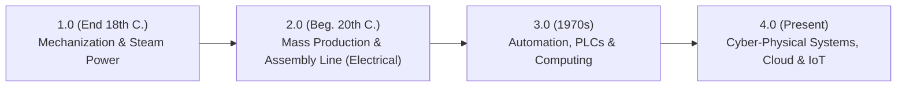

# Industry 4.0, IIoT Architectures, Big Data (5 Vs), Digital Twins & The Role of the DPA Specialist
*Date: 16-10-2026* | *Category: #industry-4-0 #iiot #big-data #process-analytics #emerging-tech*

---

## Context — Kontext

**🇬🇧** Today we concluded **Lernfeld 2.2 (IT Systems & Hardware Infrastructure)** with a forward-looking module on the **Fourth Industrial Revolution (Industry 4.0)**. We analyzed Cyber-Physical Systems (CPS), smart factories, the divergence between consumer IoT and **Industrial IoT (IIoT)**, the **5 Vs of Big Data**, the implementation of **Digital Twins** for predictive maintenance, and formulated our specific professional role as **Fachinformatiker Daten- und Prozessanalyse (DPA)** in modern connected enterprises.

**🇩🇪** Heute haben wir **Lernfeld 2.2 (IT-Systeme - Komponenten und Peripherie)** mit einem zukunftsorientierten Ausblick auf die **Vierte Industrielle Revolution (Industrie 4.0)** abgeschlossen. Wir haben cyber-physische Systeme (CPS), Smart Factories, die Abgrenzung zwischen Consumer-IoT und **Industrial IoT (IIoT)**, die **5 Vs von Big Data**, den Einsatz von **digitalen Zwillingen (Digital Twins)** für Predictive Maintenance sowie das Berufsbild des **Fachinformatikers für Daten- und Prozessanalyse (DPA)** in der vernetzten Industrie erarbeitet.

---

## Key Topics — Hauptthemen

### 1. The Four Industrial Revolutions — Von der Dampfmaschine zu Industrie 4.0

- **Industry 4.0 Core Philosophy:** Autonomous machines and manufacturing components communicating in real time through decentralized networks, self-optimizing production schedules with zero human bottleneck intervention.

---

### 2. Consumer IoT vs. Industrial IoT (IIoT) — IoT vs. IIoT

| Dimension | Consumer IoT (Internet of Things) | Industrial IoT (IIoT) |
|---|---|---|
| **Primary Domain / Fokus** | Smart Home, wearables, personal convenience / Privater Komfort. | Smart factories, automotive robotics, power grids, logistics / Industrie. |
| **Reliability & Latency** | Best-effort tolerance; minor delay is acceptable / Hohe Fehlertoleranz. | **Mission-critical, deterministic real-time** ($<1\text{ ms}$ latency), $99.999\%$ uptime. |
| **Protocols & Standards** | Wi-Fi, Bluetooth BLE, Zigbee, Matter. | **OPC UA** (industrial interoperability standard), **MQTT**, Industrial Ethernet (PROFINET). |
| **Security Risk Profile** | Individual privacy risk / Privatsphäre. | Risk of catastrophic industrial physical damage, production halt, worker safety hazards. |

---

### 3. Big Data: The 5 Vs Framework — Die 5 Vs von Big Data

**🇬🇧** Big Data describes data collections whose volume, velocity, and complexity exceed the capacity of traditional relational database engines:
**🇩🇪** Big Data beschreibt Datenbestände, deren schiere Größe und Komplexität relationale Standardsysteme überfordern:

| Big Data "V" | Definition / Bedeutung | Real-World Smart Factory Context |
|---|---|---|
| **1. Volume (Volumen)** | Sheer massive scale of data generated. | Terabytes of acoustic and vibration sensor data logged daily across $500$ CNC machines. |
| **2. Velocity (Geschwindigkeit)** | Frequency and speed of continuous data streams. | Real-time sensor readings emitted every $10\text{ milliseconds}$ over MQTT brokers. |
| **3. Variety (Vielfalt)** | Structural diversity across unstructured, semistructured, and tabular data. | Combining JSON telemetry logs, high-resolution thermal imaging videos, and SQL ERP order tables. |
| **4. Veracity (Wahrhaftigkeit)** | Data quality, signal noise, accuracy, and reliability. | Filtering out false sensor spikes and electromagnetic interference before analytics. |
| **5. Value (Wert)** | Extracting actionable commercial insight and process efficiency. | Translating raw machine vibration telemetry into proactive downtime prevention. |

---

### 4. Digital Twins & Predictive Maintenance — Digitale Zwillinge

- **Digital Twin (*Digitaler Zwilling*):** A dynamic virtual software replica of a physical machine, process, or production line updated in real time via live IIoT sensor telemetry.
- **Predictive Maintenance (Vorausschauende Instandhaltung):** Machine Learning models analyze temperature, friction, and motor vibration anomalies within the Digital Twin to schedule component replacement **before** an unexpected breakdown halts the assembly line.

---

### 5. Professional Mandate: The Role of the DPA Specialist — Rolle des DPA in Industrie 4.0

**🇬🇧 The Bridge between OT and IT:**
- The *Fachinformatiker Daten- und Prozessanalyse* acts as the indispensable translator between **Operational Technology (OT)** (production floor machines, sensors, PLCs) and **Information Technology (IT)** (cloud data lakes, ERP/WWS, Power BI dashboards).
- **Core Activities:** 1. Identifying data bottlenecks, 2. Designing reliable ETL pipelines from industrial sensors to central databases, 3. Visualizing live KPIs to eliminate process waste (*Kaizen/Muda*), 4. Ensuring strict compliance with DSGVO and industrial cybersecurity standards.

**🇩🇪 Das Bindeglied zwischen OT und IT:**
- Der Fachinformatiker für Daten- und Prozessanalyse schlägt die Brücke zwischen der operativen Fertigungsebene (**OT** - Sensoren, SPS) und der Management-Software (**IT** - ERP, Cloud, BI-Dashboards).
- **Kernaufgaben:** Datenpipelines aufbauen, Maschinendaten bereinigen, Prozessengpässe mittels Process Mining aufdecken und Kennzahlen für die kontinuierliche Prozessoptimierung bereitstellen.

---

## Key Takeaway — Was ich gelernt habe

**🇬🇧**
- **Data without process context is useless (The 5th V: Value):** Logging petabytes of industrial sensor data produces zero economic return unless process analysts transform those signals into automated predictive actions.
- **DPA is the core driver of Industry 4.0:** Automated smart factories cannot function on hardware alone — they require data pipelines, protocol integration (OPC UA $\rightarrow$ Cloud), and rigorous process modeling.

**🇩🇪**
- **Daten ohne Prozessverständnis sind wertlos (Das 5. V: Value):** Milliarden von Sensordaten erzeugen keinen Mehrwert, wenn sie nicht durch Prozessanalysten in vorbeugende Wartung und Effizienzgewinne übersetzt werden.
- **DPA ist der operative Kern von Industrie 4.0:** Vernetzte Fabriken leben von sauberen Datenströmen — die Kernaufgabe des DPA besteht darin, Rohdaten aus der Fertigung in valide Entscheidungsgrundlagen zu überführen.
